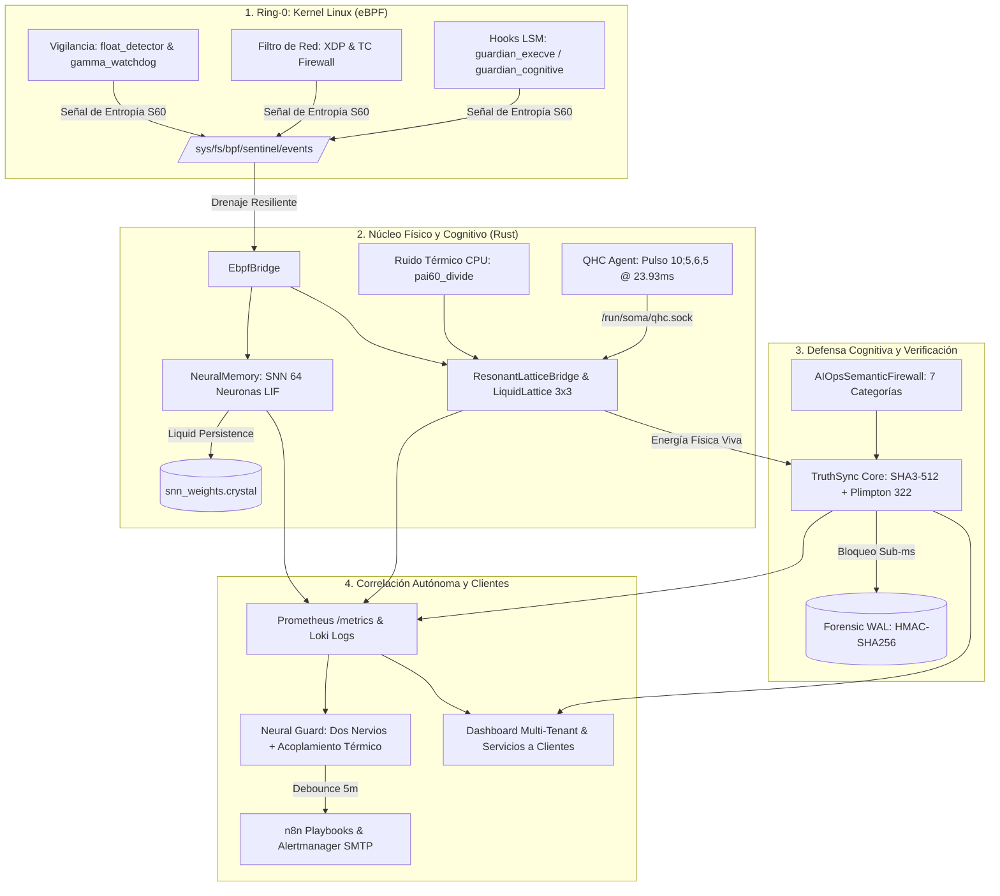

# 🛡️ Sentinel Cortex — Plataforma Soberana de Seguridad Cognitiva y Sistemas en Base-60

[](./LICENSE)
[](./Cargo.toml)
[](./ebpf/)
[-success.svg)](./me-60os-core/src/spa.rs)

**Autor:** Jaime Novoa Sepúlveda  
**Arquitectura:** Seguridad en Ring-0 (eBPF) + Memoria Resonante de Cristales + Red Neuronal de Impulsos (SNN LIF) + Firewall Semántico AIOpsShield sobre Aritmética Sexagesimal Exacta ($60^4$).

---

## 1. Fundamento Científico y Matemático: Por qué Base-60⁴

La computación convencional utiliza punto flotante binario (IEEE 754) y base decimal. En binario, fracciones elementales de la física y la simetría ($1/3$, $1/6$, $1/12$, $1/60$) son periódicas infinitas y acumulan errores sistemáticos de redondeo en cada ciclo de reloj. En un sistema de tiempo real, criptografía dinámica o resonancia acoplada, una sola operación en punto flotante contamina toda la cadena de cálculo, induciendo deriva de fase y degradación de memoria.

**Sentinel erradica el punto flotante de su núcleo** e implementa **Matemáticas Sexagesimales / Aritmética Posicional Sexagesimal (SPA)** en escala entera pura sobre **Base-60⁴**:

$$\text{SCALE}_0 = 60^4 = 12\,960\,000$$

* **Divisibilidad Universal (Cero Truncamiento)**: $60$ es el único número divisible simultáneamente por $1, 2, 3, 4, 5, 6, 10, 12, 15, 20, 30$. Las divisiones armónicas y rotaciones de fase son **100% exactas en números enteros, eliminando el truncamiento decimal**.
* **Suite de Librerías Matemáticas Sexagesimales**:
  * **`SPA` (`me-60os-core/src/spa.rs`)**: Tipo numérico fundamental en punto fijo Base-60⁴ ($60^4 = 12\,960\,000$) que sustituye a `f32`/`f64` para operar sin pérdida de precisión ni truncamiento.
  * **`PAI / PAI-60` (`me-60os-core/src/pai60_lib.rs`)**: Librería de razones recíprocas babilónicas que convierte magnitudes binarias a amplitudes exactas (`pai60_divide`) mediante multiplicación por inversos regulares en base-60.
  * **`S60` (`sentinel-cortex/src/math/s60.rs`)**: Aritmética sexagesimal escalada para métricas, relojes y controladores del Cortex.
  * **`s60_complex / spa_complex` (`me-60os-core/src/spa_complex.rs`)**: Álgebra de números complejos sexagesimales exactos ($\alpha + i\beta$) para fases, superposición y rotaciones unitarias sin deriva trigonométrica.
  * **`physics.rs` (`me-60os-core/src/physics.rs`)**: Motor de ecuaciones físicas resonantes (carga efectiva, acoplamiento térmico, amortiguación y transferencia de energía) calculadas íntegramente sobre `SPA` sin tocar coma flotante.
  * **`spa_math.rs` (`me-60os-core/src/spa_math.rs`)**: Funciones trascendentales (`sin`, `cos`, `sqrt`, `ln`, `exp`) implementadas por series de Taylor e interpolación sexagesimal pura.
* **Ancla Matemática Inmutable**: Las frecuencias naturales de los osciladores se derivan de la **Tabla Babilónica Plimpton 322** (~1800 a.C., Fila 12: ratio exacto $62\,159\,999$ en escala S60, triplete pitagórico $1679, 2400, 2929$).
* **Candado YATRA**: Reforzado a nivel de compilador (`clippy::float_arithmetic = "deny"`, `float_cmp = "deny"`) y supervisado en el kernel Linux por el programa eBPF `float_detector.c`.
---

## 2. Arquitectura Encadenada del Sistema

Sentinel no es una colección de herramientas aisladas; es un **sistema nervioso continuo** donde cada capa resuelve y alimenta a la siguiente de forma determinista:



---

## 3. Pilares Tecnológicos Implementados

### 🛡️ 3.1. Protección a Nivel de Kernel (Ring-0 eBPF)
* **`guardian_alpha_lsm.c`**: Hook LSM en `bprm_check_security` que intercepta cada ejecución de proceso (`execve`), evalúa listas blancas en mapas BPF y calcula la entropía del evento en escala S60 ($0.85 \times \text{SCALE}_0$ para amenazas bloqueadas; $0.15 \times \text{SCALE}_0$ para flujo normal).
* **`guardian_cognitive.c` & `float_detector.c`**: Supervisión de integridad de procesos de IA y detección de contaminación de registros en coma flotante.
* **`xdp_firewall.c` & `tc_firewall.c`**: Mitigación de ráfagas de red y filtrado de paquetes en la tarjeta de red antes de que alcancen el stack TCP/IP del sistema operativo.

### 💎 3.2. Memoria de Cristales en 3 Niveles (Doble Malla + SHM + Compresión Fractal)
La información crítica en Sentinel no vive en una celda de memoria aislada, sino en la **resonancia colectiva** de una red de osciladores piezoeléctricos virtuales (`SovereignCrystal`):
1. **Nivel 1 — Simpatía Hexagonal (`ResonantMatrix`)**: Cada nodo transfiere energía a sus 6 vecinos hexagonales mediante $\text{flow} = (\Delta A \times \text{coupling}) / 6$ con factor de acoplamiento $10/60$ y amortiguación termodinámica $\text{S60}(0,0,30)$. Si un nodo sufre daño, sus vecinos lo recargan por simpatía.
2. **Nivel 2 — Anclaje en Memoria Compartida (`shm_bridge.rs`)**: Las mallas se proyectan fuera del heap del proceso hacia `/dev/shm` (`MAP_SHARED`), sobreviviendo a caídas de procesos y desprogramación del sistema operativo bajo carga extrema.
3. **Nivel 3 — Compresión Fractal y Portal Dual (`resonant_lattice_memory.rs`)**: Se inyecta únicamente la **semilla** tras el bombeo QHC. El dato solo es accesible cuando **ambas mallas (Lane A ∧ Lane B) convergen en fidelidad colectiva**, reconstruyendo el estado al 100%.

### 🕰️ 3.3. Motor Temporal en Cristales y Agente QHC
* **Intervalo de Tick Inmutable**: $\Delta t = 23\,939\,835\text{ ns}$ ($\approx 41.7713\text{ Hz}$), derivado del divisor $17 \times 60^3 = 3\,672\,000$ en resonancia armónica 2:1 con la Fila 12 de Plimpton 322.
* **Reseteadores de Fase**: Corrección activa de deriva (*drift*) respecto al reloj monótono de hardware, ejecutando el **Salto-17** cada 17 ticks y modulando la fase bajo la secuencia $P = \{10, 5, 6, 5\}$ a través del socket Unix `/run/soma/qhc.sock`.

### 🧠 3.4. Red Neuronal de Impulsos (PAI-Neural SNN LIF)
* Implementación nativa en Rust (`me-60os-core/src/neural_memory.rs`) de 64 canales de neuronas **Leaky Integrate-and-Fire (LIF)** en punto fijo S60.
* Integra en tiempo real los pulsos de entropía provenientes del kernel eBPF y del acoplamiento térmico del CPU.
* **Persistencia Líquida (`.crystal`)**: Serialización binaria directa a disco (`CRYSTAL_SNN_V1`) que preserva los potenciales de membrana y el conteo de disparos (*spikes*) a través de reinicios.

### 🔥 3.5. AIOpsShield, Firewall Semántico y TruthSync Core
* **Defensa AIOpsDoom (`semantic_firewall.rs`)**: Inspección pre-ingestión en 7 categorías cognitivas (inyección de comandos, evasión de rol, exfiltración, manipulación de pesos, SQLi, XSS y sabotaje de infraestructura).
* **TruthSync Core (`truthsync-core/`)**: Motor de verificación de afirmaciones con latencia $< 100\,\mu\text{s}$ en compilación release, utilizando `AhoCorasick` de salida temprana y resumen criptográfico **SHA3-512** atado físicamente a la energía instantánea del lattice.
* **WAL Forense (`forensic_wal.rs` & `SecurityWal`)**: Registro de auditoría de doble carril (*Dual-Lane*) con firmas encadenadas HMAC-SHA256, nonces monótonos anti-replay y volcado síncrono `fsync` a disco.

### 👁️ 3.6. Neural Guard: Correlación de Dos Nervios y Monitoreo Multi-Tenant
* **Dos Nervios (`services/neural-guard/`)**: Cruza de manera independiente el **Nervio A** (intrusión, syscalls, SSH, auditd) con el **Nervio B** (integridad de respaldos, certificados, almacenamiento), escalando la severidad cuando ambos nervios confirman un incidente.
* **Acoplamiento Térmico Entero**: Escala dinámicamente los umbrales de detección según la temperatura real del procesador usando física resonante S60 sin conversiones flotantes.
* **Observabilidad Completa y SLA de Clientes**:
  * Monitoreo continuo de servicios entregados a clientes: **DNS Autoritativo (`pdns`), Correo (`postfix`/`dovecot`), Portal Web, Cortex Gateway y VPN (`wg0`)**.
  * Dashboards aprovisionados en **Grafana** (Infraestructura de Host, Bases de Datos Postgres/Redis, Logs en Loki, Lattice Core y SLA Multi-Tenant).
  * Notificaciones de alerta por correo electrónico vía **Alertmanager + Postfix** y ejecución de playbooks en **n8n**.

---

## 4. Estructura del Workspace y Módulos

```text
sentinel/
├── me-60os-core/            # Núcleo matemático y físico en Rust (lib: me60os_core + 32 binarios)
│   ├── src/spa.rs           # Tipo fundamental SPA (Base-60⁴, SCALE_0 = 12,960,000)
│   ├── src/pai60_lib.rs     # Tabla recíproca babilónica PAI-60 y división exacta
│   ├── src/resonant_matrix.rs # Malla hexagonal 2D, transferencia por simpatía y warm-up
│   ├── src/neural_memory.rs # Red neuronal SNN LIF de 64 canales + persistencia .crystal
│   ├── src/dual_lane.rs     # Segregación de telemetría Security Lane vs Observability Lane
│   ├── src/qhc.rs & qhc_ipc.rs # Modulador de fase 10;5,6,5 y protocolo de socket Unix
│   └── src/bin/             # Experimentos EXP-001..034, benchmarks y daemons nativos
├── sentinel-cortex/         # Servidor principal Axum REST/WS y orquestador de tiempo real
│   ├── src/main.rs          # Bucle térmico PAI-60, ingesta eBPF, rutas API y exportador Prometheus
│   ├── src/dashboard.rs     # Telemetría real de host, anomalías, respaldos y estado multi-tenant
│   ├── src/ebpf_cortex_bridge.rs # Lector resiliente con reconexión continua al ringbuffer eBPF
│   └── src/security/        # AIOpsSemanticFirewall, ForensicWal, MutualSurveillance, BioResonance
├── truthsync-core/          # Motor de verificación semántica y certificación S60 (<100μs)
├── services/neural-guard/   # Motor de correlación de incidentes (Dos Nervios + Debounce 5m)
├── sentinel-verifier/       # Daemon de verificación continua de invariantes del sistema
├── ebpf/                    # Programas en C para el kernel Linux (LSM, XDP, TC, Watchdog)
├── guardian-alpha/          # Módulos C/Python de integración Ring-0, relés y pruebas de latencia
├── bci/                     # Firmwares Arduino y puentes de resonancia neuro-háptica
├── frontend/                # Interfaz web Next.js 16 (Dashboard, Lattice 3D, Analítica, Watchdog)
├── backend/                 # Modelos multi-tenant, suites de benchmarks comparativos y fuzzers
├── observability/           # Configuraciones de Prometheus, Loki, Promtail, Alertmanager y Grafana
├── openrc/                  # Scripts de servicios nativos para Alpine Linux (Init OpenRC)
├── scripts/                 # Bootstrap de producción, respaldos programados y validador zero-trust
└── docs/                    # Acervo documental clasificado (00_fundamentos a 07_prompts + specs)
```

---

## 5. Organización del Acervo Documental (`docs/`)

Toda la investigación teórica, pruebas empíricas y especificaciones de operación se encuentran estructuradas en `docs/`:

* **`docs/00_fundamentos/`**: Manifiesto de arquitectura, dossier técnico, diagramas UML y diseño de módulos.
* **`docs/01_produccion_actual_fenix/`**: Planes de despliegue en nodo Fénix, configuración de respaldos, alta disponibilidad y seguridad.
* **`docs/02_ciencia_y_quantum/`**:
  * [`research/base60_mathematics.md`](./docs/02_ciencia_y_quantum/research/base60_mathematics.md) — Demostración de superioridad numérica sexagesimal.
  * [`research/TesisResonancia.md`](./docs/02_ciencia_y_quantum/research/TesisResonancia.md) — Tesis de Resonancia e inteligencia mecánica fonónica.
  * Reportes de benchmarks reales (`BENCHMARK_CORE_S60_BASELINE`, pruebas de estrés de 5000 reqs, latencias PAI-60).
* **`docs/03_audits/` & `docs/03_gobernanza/`**: Auditorías de código 360°, verificaciones en vivo de eBPF LSM y matriz de trazabilidad.
* **`docs/04_infraestructura/`**: Diseño de redes, WireGuard y topología de servidores.
* **`docs/05_museo/` & `docs/06_traducciones/`**: Registro histórico de evolución del proyecto y papers científicos traducidos al español.
* **`docs/ops/` & `docs/specs/`**:
  * [`ops/CABLEADO_Y_TOPOLOGIA_CANONICA.md`](./docs/ops/CABLEADO_Y_TOPOLOGIA_CANONICA.md) — Mapa exacto de conexión encadenada de los 11 subsistemas en Fénix.
  * [`SPEC_AIOPS_SHIELD_RUST.md`](./docs/SPEC_AIOPS_SHIELD_RUST.md) — Especificación formal de los Claims de defensa cognitiva en Rust.

---

## 6. Resultados y Métricas Verificadas en Hardware Real

| Prueba / Benchmark | Binario / Script | Resultado Medido |
| :--- | :--- | :--- |
| **Precisión Sexagesimal vs IEEE 754** | `fpu_vs_pai_bench` / `verify_plimpton` | **0.000 ppm de deriva** en divisiones armónicas; liberación de la FPU. |
| **Enfriamiento Optomecánico Fonónico** | `opto_cooling_bench` | **99% de reducción térmica** en 13 pasos (régimen resuelto $\kappa < \omega_m$). |
| **Memoria de Cristales Doble Malla** | `resonant_lattice_memory` | **100% de fidelidad** de reconstrucción por simpatía en 5000 nodos/lane sobre `/dev/shm`. |
| **Verificación TruthSync Core** | `truthsync-core` (`--release`) | **$\approx 70\,\mu\text{s}$ por verificación** con firma SHA3-512 ligada a energía del lattice. |
| **Prueba de Estrés Concurrente** | `scripts/stress_test_sentinel.py` | **165+ req/s**, 100% de bloqueo (HTTP 403 + WAL) en los 50 payloads de ataque. |

---

## 7. Compilación, Despliegue y Verificación Zero-Trust

### 7.1. Compilar y Ejecutar toda la Suite de Pruebas en Rust
```bash
cargo build --release --workspace
cargo test --workspace
```

### 7.2. Ejecutar Demostraciones de Núcleo Físico
```bash
# Memoria de cristales con doble malla, bombeo QHC y anclaje en /dev/shm
cargo run --release -p me60os --bin resonant_lattice_memory

# Benchmark de enfriamiento optomecánico en Base-60
cargo run --release -p me60os --bin opto_cooling_bench

# Verificación de identidades exactas de la Tabla Plimpton 322
cargo run --release -p me60os --bin verify_plimpton
```

### 7.3. Auditoría de Preparación de Producción en Vivo (Alpine Linux / OpenRC)
```bash
# Verifica daemons OpenRC, programas eBPF en Ring-0, endpoints REST,
# intercepción de ataques en WAL, doble malla y persistencia .crystal
sh scripts/validate-production-readiness.sh
```

### 7.4. Bootstrap Reproducible de Nodo Nuevo
```bash
sudo sh scripts/bootstrap-production-node.sh
```

---

## 8. Licencia y Propiedad Intelectual

**Autor:** Jaime Novoa Sepúlveda — Todos los derechos reservados.  
Distribuido bajo **Licencia Apache 2.0 con Cláusula de Restricción Comercial** (ver [`LICENSE`](./LICENSE)).  
Se permite la colaboración abierta, auditoría académica y reproducción científica con atribución explícita al autor. Queda estrictamente prohibido el uso comercial, licenciamiento o explotación en servicios de terceros sin autorización escrita del autor.
